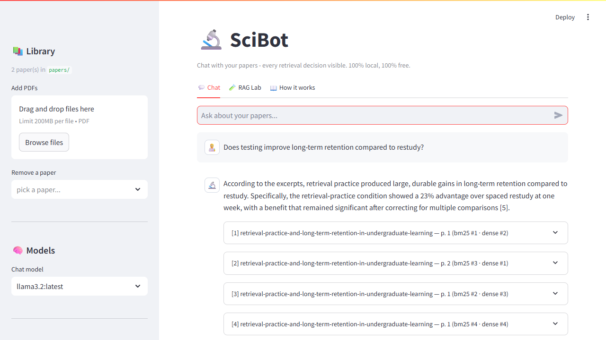

# 🔬 SciBot

**A transparent, local-first RAG playground for academic papers.**

Chat with your PDFs — and see *exactly* how every answer was built: which
retrieval strategy found each passage, how it was scored, the full prompt,
and the exact PDF page behind every citation. 100% local, 100% free, no API
keys, no accounts. Your papers never leave your machine.



## Why

Researchers spend a huge amount of time digging through papers to understand
existing work. SciBot was built to accelerate early-stage literature
exploration — and, just as importantly, to *show its work*. Most RAG
frameworks hide retrieval behind a black box; SciBot is small enough
(~1,500 lines total, no framework) that you can read every step, and the UI
exposes every decision so you can learn *why* an answer looks the way it does.

## Quickstart

1. Install [Ollama](https://ollama.com), then pull the models:

   ```bash
   ollama pull llama3.2
   ollama pull nomic-embed-text
   ```

2. Install SciBot (Python 3.10+):

   ```bash
   pip install -r requirements.txt
   ```

3. Run it:

   ```bash
   ollama serve            # if it isn't already running
   streamlit run app.py
   ```

On first launch SciBot adds two synthetic demo papers and builds the index,
so you can ask a real question about a minute after cloning. Upload your own
PDFs in the sidebar whenever you like.

> Hardware note: llama3.2 (3B) runs comfortably on 8 GB of RAM. Any chat
> model in your Ollama library can be selected in the sidebar — a bigger
> model gives better answers if you have the VRAM.

## What's inside

| Technique | Where | What it buys you |
|---|---|---|
| Page-aware chunking with overlap | `scibot/chunking.py` | Exact page citations; cached embeddings survive re-chunking |
| Dense retrieval (nomic-embed-text) | `scibot/embed.py`, `scibot/store.py` | Finds passages by *meaning*, even with zero word overlap |
| Okapi BM25, implemented from scratch | `scibot/bm25.py` | Finds exact terms: acronyms, author names, statistics |
| Hybrid search + Reciprocal Rank Fusion | `scibot/retrieval.py` | Both signals fused by rank — no score normalisation needed |
| Multi-query expansion | `scibot/retrieval.py` | LLM rewrites your question into academic phrasing, results fused |
| Conversational follow-ups | `scibot/generation.py` | "and does it hold for kids?" becomes a standalone search query |
| Groundedness self-check | `scibot/generation.py` | A second pass flags claims the excerpts don't support |
| **RAG Lab** | `app.py` | One question through all three strategies, side by side |

Every knob is in the sidebar: strategy, chunks per answer, chunk size and
overlap, multi-query, groundedness. Change the chunking and the index
rebuilds automatically — embeddings are content-hashed, so only genuinely
new text gets re-embedded.

## The pipeline

```
 PDF ──► parse (pymupdf) ──► chunk per page ──► embed (nomic-embed-text)
                                                  │
                    ┌─────────────────────────────┘
                    ▼
  your question ──► embed query ──┐
                    │             ▼
                    ├──► cosine similarity  (dense ranking)
                    ├──► Okapi BM25         (keyword ranking)
                    │             │
                    ▼             ▼
                   Reciprocal Rank Fusion (RRF)
                                  │
                                  ▼
                   top-k chunks ──► LLM ──► cited answer
```

The in-app **How it works** tab explains each stage and suggests experiments
worth running against your own library.

## Project layout

```
app.py                     Streamlit UI (chat, RAG Lab, how-it-works)
scibot/
  config.py                paths + tunable defaults
  pdf.py                   PDF parsing (PyMuPDF)
  chunking.py              page-aware sliding-window chunks
  bm25.py                  readable Okapi BM25 (~40 lines)
  embed.py                 Ollama embeddings + content-addressed disk cache
  store.py                 the Library: index build, persistence, search
  retrieval.py             dense / bm25 / hybrid + RRF + multi-query
  generation.py            prompts, streaming answers, groundedness check
  samples.py               synthetic demo papers (generated on first run)
scripts/
  make_sample_papers.py    regenerate demo PDFs without the app
  smoke_test.py            headless end-to-end pipeline check
tests/
  test_pipeline.py         unit + integration tests (no server needed)
```

## Testing

```bash
python -m pytest tests/ -q          # unit tests (offline, deterministic)
python scripts/smoke_test.py        # full pipeline incl. Ollama
```

## Ideas welcome

Good first issues for anyone who wants to poke at this:
cross-encoder reranking behind a toggle, an evaluation harness (retrieval
hit-rate over a small Q/A set), citation highlight-jumping in the PDF view,
exporting chat threads with sources, or a `uv`-based one-liner install.

## License

MIT.
